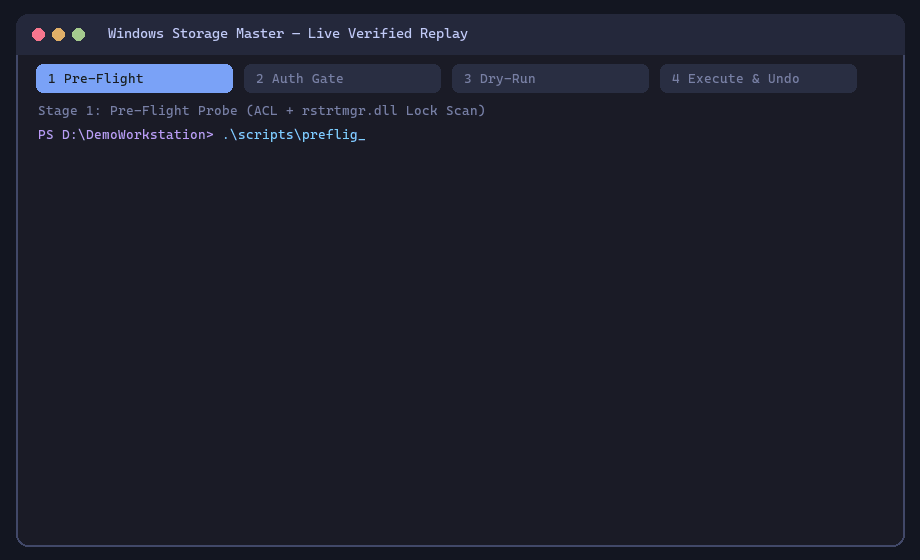

<sub>🌐 <a href="README.md">中文</a> · <b>English</b></sub>

<div align="center">

# Windows Storage Master | windows-storage-ops

> *"Generic disk cleaners only sweep Temp files. What truly drags down a Windows dev workstation are bloated WSL/Docker VHDXs, duplicate Git worktree `node_modules`, RAM-hungry full-text indexers, and fragile directory coupling."*

[](SKILL.md)
[](https://skills.sh/yuwen773/windows-storage-ops)
[](https://github.com/yuwen773/windows-storage-ops/actions/workflows/ci.yml)
[](SKILL.md)
[](SKILL.md)
[](SKILL.md)
[](LICENSE)

**An end-to-end Windows 10/11 storage governance skill for developers: fast read-only auditing, structured `AskUserQuestion` decisions, and logged, authorization-gated, reversible PowerShell cleanup & migration.**

[Real Case Study](examples/real-workstation-case.md) · [Quick Start](#quick-start) · [Safety Boundaries](#safety-boundaries) · [Tests](tests/test-prompts.json)

</div>

---


<sub>Live sandbox replay (Pre-Flight Probe → Auth Gate Block → Dry-Run Preview → Authorized Execute + Auto LIFO Undo), reproducible via <a href="demo/capture-real-demo.ps1">demo/capture-real-demo.ps1</a> and <a href="demo/render_demo_gif.py">demo/render_demo_gif.py</a>.</sub>

---

## Why This Skill Exists

Most cleanup skills stop at deleting `%TEMP%` and browser caches. On a real Windows developer workstation running Java/Node/Python, Docker, WSL2, MySQL, and multiple AI coding agents, the real risks lie in **migration and hidden coupling**:
- Raw `Move-Item` silently **half-splits** multi-GB folders on a single ACL or lock error;
- PowerShell 5.1 `Remove-Item -Recurse` silently fails on deep `node_modules` (>260-char `MAX_PATH`);
- Moving repos breaks Git worktree pointers, `.venv` shims, and AI agent path-keyed session history;
- Moving caches without auditing cross-tool env vars (like `GRADLE_USER_HOME`) causes deleted folders to resurrect.

`windows-storage-ops` encodes these hard-won engineering safeguards into **zero-API, native PowerShell 5.1 automation** with interactive `AskUserQuestion` checkpoints, transcript logs, and auto-generated LIFO undo scripts.

---

## Quick Start

```bash
npx skills add yuwen773/windows-storage-ops
```

First prompt after installing:

```text
Run a read-only deep disk audit of my Windows drives first without modifying anything, then use interactive choices to let me select cleanup and relocation actions.
```

---

## Key Differentiators

- **24x Faster Read-Only Collector (`fast-audit.ps1`)**: Uses multi-threaded native `robocopy /L /XJ` to scan 4M+ files in minutes while checking RAM pressure, Everything `include_file_content`, DB schema counts (zero row reads), cross-tool env vars, and Git worktree dirty file counts.
- **OS-Level File Lock Detection (`rstrtmgr.dll`)**: Identifies exact GUI processes (e.g., editors/IDEs) holding handles before attempting moves.
- **Hard Authorization Gate + Auto Undo (`invoke-storage-plan.ps1`)**: Defaults to `-DryRun`, refuses execution without `-Execute -ConfirmedByUser`, writes full logs + JSON deltas to `%LOCALAPPDATA%\windows-storage-ops\logs\`, and auto-generates LIFO `undo_<timestamp>.ps1`.
- **Interactive-First Agent UX**: Enforces structured `AskUserQuestion` / `ask_question` UI choices (with automatic numbered-menu fallback for CLI runtimes).

---

## Safety Boundaries

- Read-only discovery modifies zero files, never starts stopped Docker/WSL/DB services, and never reads secrets or database business rows.
- Never touches `WinSxS`, `Windows\Installer`, active databases, or dirty Git worktrees as trash.
- Never recommends fragile cross-volume NTFS Junction hacks for Electron/AI Agent folders or IDE-managed JDKs.

## License

[MIT](LICENSE)
