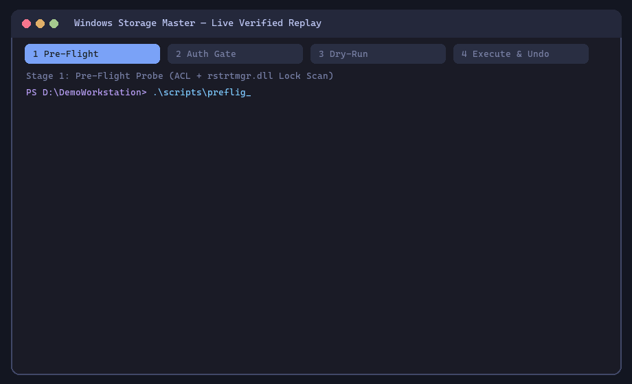

<sub>🌐 <b>中文</b> · <a href="README.en.md">English</a></sub>

<div align="center">

# 磁盘清理大师 | windows-storage-ops

> *「普通清理工具只会帮你删 Temp；真正拖垮 Windows 开发机的，是藏在深水区的虚胖虚拟盘、满地乱爬的 Worktree、吃光内存的全文索引和一挪就炸的目录耦合。」*

[](SKILL.md)
[](https://skills.sh/yuwen773/windows-storage-ops)
[](https://github.com/yuwen773/windows-storage-ops/actions/workflows/ci.yml)
[](SKILL.md)
[](SKILL.md)
[](SKILL.md)
[](LICENSE)

**面向 Windows 开发者的全链路存储治理 Skill：先只读体检，再用交互式选择题决策，最后用带日志、强制授权门、自动生成回滚脚本的 PowerShell 引擎安全清理与迁移。**

[真实战绩](#真实战绩脱敏实测) · [快速开始](#快速开始) · [触发方式](#触发方式) · [与同类有什么不同](#它和同类有什么不同) · [安全边界](#安全边界) · [验证与测试](#验证与测试)

</div>

---


<sub>实机沙箱录制回放（Pre-Flight 句柄探针 → 硬授权门拦截 → 默认 Dry-Run 预览 → 授权执行 + 自动 LIFO Undo 还原），可由 <a href="demo/capture-real-demo.ps1">demo/capture-real-demo.ps1</a> 与 <a href="demo/render_demo_gif.py">demo/render_demo_gif.py</a> 一键复现。</sub>

---

## 它解决什么问题

事情通常是这样的：你的 1 TB Windows 开发机用了一年半，C 盘飘红只剩 20%，D 盘根目录铺着 30 多个叫 `code`、`Work`、`software`、`programe`、`tmp` 的文件夹，16 GB 内存常年飙到 95%。

普通的清理工具甚至普通的清理 Skill，只能帮你删掉几 GB 的 `Temp` 和回收站——**真正占着上百 GB、还动不动一挪就炸的硬骨头它们根本碰不了**：
- 用 `Move-Item` 搬 35 GB 目录，中途撞上一个锁定文件直接把文件夹**撕成两半**；
- 用 PowerShell 5.1 删 `node_modules`，撞上 260 字符 `MAX_PATH` 静默删不掉；
- 删旧 MySQL 才发现活跃项目库还在里面；迁完 Maven 仓库才发现 `GRADLE_USER_HOME` 还在偷偷把旧目录生回来；
- 关了一堆软件，还是不知道到底是后台哪个 GUI 进程锁住了文件夹句柄。

**磁盘清理大师**把这一整套 Windows 深水区工程经验封进了 **只读快检 → `AskUserQuestion` 点选决策 → 预演/授权/留痕/可回滚执行** 的标准闭环里，**零 API Key、全原生 PowerShell 5.1**，开箱即用。

---

## 真实战绩（脱敏实测）

在一台 1 TB NVMe + 16 GB 内存的真实全栈 + AI 开发机上跑完完整 4 阶段闭环（完整脱敏过程见 [examples/real-workstation-case.md](examples/real-workstation-case.md)）：

| 实测指标 | 治理前 | 治理后 | 真实变化 |
|---|---:|---:|---|
| **C 盘空闲（300 GB）** | 66.00 GB（22.0%） | **137.39 GB（45.8%）** | **+71.39 GB（空闲翻倍）** |
| **D 盘空闲（653 GB）** | 267.34 GB（40.9%） | **349.07 GB（53.5%）** | **+81.73 GB**（含承接 23 GB WSL/Docker 虚拟盘） |
| **双盘合计净释放** | 333.34 GB | **486.46 GB** | **+153.12 GB** |
| **Everything 索引库** | 7.54 GB（双库） | **59.6 MB** | **瘦身 126 倍**（抓出全盘 `include_file_content=1` 元凶） |
| **16 GB 内存占用** | 96.2% | **69.3%** | **释放 ~4 GB 常驻内存** |
| **C + D 全盘只读审计耗时** | 91 分钟（手写递归） | **3.8 分钟（228.5 秒）** | **提速 24 倍**（覆盖 430 万+ 文件） |
| **数据库与工具链清理** | 双 MySQL、17 条死 PATH | **统一 MySQL 8.0（3306）、0 死 PATH** | 清掉 331 个自动化测试脏库 + 115 个归档构建产物 |

---

## 快速开始

### 安装（跨 Agent Runtime 通用）

```bash
# 方式 1：通过 skills CLI 一行安装
npx skills add yuwen773/windows-storage-ops

# 方式 2：手动克隆到全局 Skills 目录（Antigravity / Claude Code / Codex / Cursor 均兼容）
git clone https://github.com/yuwen773/windows-storage-ops ~/.gemini/config/skills/windows-storage-ops
```

装完后，直接对你的 Agent 说这**第一句话**：

```text
用磁盘清理大师帮我做一次只读全面磁盘审计，先不要删任何文件，审计完用选项让我挑要清理和迁移的项。
```

---

## 触发方式

以下真实自然语言均可触发本 Skill：
- “用磁盘清理大师体检一下我的 C 盘和 D 盘”
- “C 盘又红了，帮我安全清理一下开发缓存”
- “我的 D 盘目录太乱了，帮我看看怎么合理规划目录和软件位置”
- “帮我把 WSL2 / Docker / Maven / MySQL 迁到 D 盘”
- “清理一下老项目里的 `node_modules` 和过期 Git Worktree”
- “这个文件夹移动报 Access Denied，帮我查一下后台是谁锁住了”
- “跑一下季度存储健康巡检”

---

## 工作流与交付物

| 阶段 | 核心能力 | 交互与产物 |
|---|---|---|
| **1. 只读深度体检** | `fast-audit.ps1` 原生多线程扫描 C/D 盘、内存 Top 进程、Everything `.ini`、数据库库名计数、跨工具环境变量、Git Worktree 脏度 | 结构化 P0–P3 审计报告 + 4 桶可回收评估（**绝对零修改**） |
| **2. 交互式决策** | 强制调用 Agent 的 **`AskUserQuestion` / `ask_question`** 交互组件让用户点选（不支持的 Runtime 自动降级为编号菜单） | 零手打繁琐确认，清晰呈现推荐项与风险权衡 |
| **3. 安全清理与迁移** | `preflight-check.ps1`（含 `rstrtmgr.dll` 句柄查锁）→ `invoke-storage-plan.ps1` 先 `-DryRun` 预演 → 用户授权后 `-Execute -ConfirmedByUser` 执行 | 完整 `run_*.log` 日志 + `result_*.json` 空间前后差值 + **自动生成 LIFO `undo_*.ps1` 回滚脚本** |
| **4. 季度防反弹巡检** | `quarterly-audit.ps1` 5 秒体检盘面水位、归档构建产物、Everything 开关、失效环境变量 | 快速发现缓存反弹与配置漂移 |

---

## 它和同类有什么不同

| 维度 | 常见 Windows 清理 Skill | 磁盘清理大师 (`windows-storage-ops`) |
|---|---|---|
| **核心重心** | 以清理 Temp / 浏览器缓存为主 | **审计 + 清理 + 目录/工具链/服务零破坏迁移**全闭环 |
| **防撕裂与长路径** | 常用 PowerShell 原生 `Move-Item` / `Remove-Item` | 封装 **`Move-DirAtomic`**（全成或全败）与 **`Remove-LongPathDir`**（破 260 字符 `MAX_PATH`） |
| **隐蔽句柄锁诊断** | 遇 `Access Denied` 直接失败 | 内置 Windows Restart Manager（**`rstrtmgr.dll`**）直报精确锁定 PID 与软件名 |
| **开发者深水区耦合** | 较少处理跨工具联动 | 覆盖 **Git Worktree 脏度检查与双向指针修复**、MySQL 库名检查与 `sc.exe config` 服务迁移、跨工具环境变量（`GRADLE_USER_HOME`）与 `Sync-ProcessEnv` 防目录复活 |
| **反过度设计护栏** | 常建议全盘软链搬家 | 显式禁止对 Electron/AI Agent 和 IDE 托管 JDK 做高危 Junction，防范标准增殖 |
| **Agent 交互体验** | 文本提问让用户手打回复 | 强制优先调用 **`AskUserQuestion` / `ask_question`** 结构化点选 |

---

## 安全边界

- **审计阶段绝对只读**：不删改任何文件、不自启已停止的 Docker/WSL/MySQL、不读私人文档/`.env`/密钥/数据库表业务行；
- **代码级授权门**：`invoke-storage-plan.ps1` 默认 `-DryRun`，不带 `-Execute -ConfirmedByUser` 拒绝执行（退出码 `2`）；确认式疑问句（“可以了吧？”）不视为授权；
- **可排查、可回滚**：每次变更自动写 `Start-Transcript` 完整日志到 `%LOCALAPPDATA%\windows-storage-ops\logs\`，并为所有可逆操作（原子移动、环境变量、PATH、配置修改）逆序生成 `undo_<timestamp>.ps1`；
- **硬保护黑名单**：绝不把 `WinSxS`、`Windows\Installer`、活跃数据库、含未提交改动的 Worktree 当作垃圾；绝不将聊天记录等不可重建数据混入 `Cache` 目录。

---

## 文件结构

```text
windows-storage-ops/
├── SKILL.md                           # 总控指令：4 阶段工作流、AskUserQuestion 协议、授权门与黑名单
├── README.md / README.en.md           # 中英双语说明与快速上手
├── CHANGELOG.md                       # 变更日志（写明"为什么改"）
├── LICENSE                            # MIT 许可证
├── .claude-plugin/marketplace.json    # Claude Code Plugin Marketplace 清单
├── .github/workflows/ci.yml           # Windows CI（AST + 隐私扫描 + 沙箱闭环 + 巡检）
├── assets/
│   └── demo.gif                       # 真实沙箱运行回放 GIF
├── demo/
│   ├── capture-real-demo.ps1          # 真实运行采集与脱敏脚本
│   ├── render_demo_gif.py             # GIF 渲染脚本（可复现）
│   └── captured_session.json          # 脱敏会话回放数据
├── references/
│   ├── deep-audit-protocol.md         # Phase 0–8 只读深度审计协议与 4 桶可回收口径
│   └── directory-governance.md        # 5 大目录支柱、命名规范与二阶耦合反例手册
├── scripts/
│   ├── fast-audit.ps1                 # 原生多线程只读深度采集器（通用零硬编码）
│   ├── preflight-check.ps1            # 动手前探针（ACL + rstrtmgr.dll 句柄锁 + 跨工具变量 + Worktree/venv）
│   ├── safe-fs.ps1                    # 安全原语库（Move-DirAtomic / Remove-LongPathDir / Sync-ProcessEnv 等）
│   ├── invoke-storage-plan.ps1        # 计划驱动执行器（默认 Dry-Run + 双开关授权门 + 日志 + 自动 Undo）
│   ├── new-admin-task.ps1             # 零嵌套引号 UAC 管理员启动器生成器（自动禁 QuickEdit）
│   ├── quarterly-audit.ps1            # 5 秒季度防反弹健康巡检
│   └── verify-skill.ps1               # 自动化自检套件（隐私/语法/JSON/沙箱回滚）
├── examples/
│   └── real-workstation-case.md       # 真实脱敏工作站治理全案（释放 153 GB）
└── tests/
    └── test-prompts.json              # 4 组自动化验收 Prompt 与断言标准
```

---

## 验证与测试

执行引擎内置端到端沙箱验证（`Auth Gate Block → Dry-Run → Authorized Execute → LIFO Undo Rollback`），验收用例清单见 [tests/test-prompts.json](tests/test-prompts.json)。你也可以直接用以下验收句测试你的 Agent：

> “请对当前电脑做一次只读磁盘审计，检查 C/D 盘占用、Everything 是否开启全文索引、以及代码目录里是否有脏 Worktree，审计完用选项让我决定下一步。”

合格表现：不修改任何文件、调用 `fast-audit.ps1` 输出真实数据、路径无幻觉转写、结束后使用 `AskUserQuestion` / `ask_question` 提供选项而非擅自执行清理。

---

## 致谢

本 Skill 在设计过程中参考了社区优秀同类作品的设计思路：[win-forge](https://github.com/omerokumus1/win-forge)、[oh-my-disk-cleaner](https://github.com/open-agent-power/oh-my-disk-cleaner)、[disk-cleaner-skills](https://github.com/xiaofenggan01/disk-cleaner-skills)、[windows-cleanup-optimize](https://github.com/hyt315/windows-cleanup-optimize) 与 [agent-cleanup](https://github.com/luchasarie/agent-cleanup)。

## License

[MIT](LICENSE)

---

<div align="center">

*先体检，再点选，有日志，可回滚 —— 让 Windows 开发机像新装一样清爽。*

</div>
